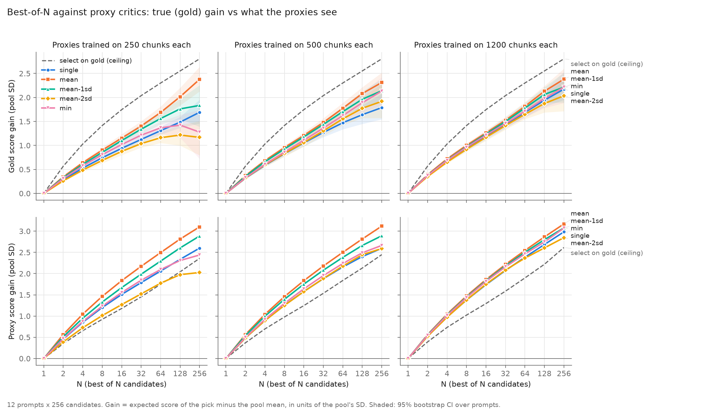

# tv-script-critic

Does a critic ensemble with a disagreement penalty reduce reward hacking
compared with a single critic, when tuning a TV script writer?

A small, CPU-friendly replication of the reward-model-overoptimization setup
(Gao, Schulman & Hilton, 2022) in a creative domain with a weak, noisy signal:
critics learn episode quality from IMDb ratings of TV transcripts, and a writer
model is optimized against them by best-of-N selection.

## Result

At N = 256, proxies trained on 500 chunks each (main setting), gain in gold score
over a random candidate, in units of the pool's standard deviation
(12 prompts × 256 candidates, 95% bootstrap CI over prompts):

| Selection rule | Gold gain | vs. the rule above it |
|---|---|---|
| Select on gold itself (ceiling) | +2.80 | |
| **Mean of 5 proxies** | **+2.31** | |
| Mean − 1 SD (disagreement penalty) | +2.14 | −0.17 [−0.35, −0.01] vs mean, worse in 12/12 prompts |
| Min of 5 (worst case) | +2.13 | −0.18 [−0.37, +0.00] vs mean |
| Mean − 2 SD | +1.92 | −0.39 [−0.62, −0.17] vs mean |
| Single proxy | +1.79 | mean beats it by +0.52 [+0.19, +0.86], in 11/12 prompts |

1. **Ensembling helps.** Averaging five proxies recovers 82% of the attainable
   gain, against 64% for a single proxy.
2. **The disagreement penalty does not help here; it costs.** Penalizing
   disagreement lowered the gold gain at every penalty strength and every proxy
   size. Disagreement barely predicts which candidates the proxies overrate
   (within-prompt Spearman +0.01 at 500 chunks, +0.17 at 250), and is slightly
   positive with true quality, so the penalty mostly discards good candidates.
3. **No overoptimization peak at this pressure.** Gold keeps rising up to
   N = 256 for the mean and the single proxy. Proxies always overstate the gain
   (single proxy: +2.60 seen vs +1.79 real). Only with the weakest proxies (250
   chunks) do the most conservative rules (min, mean − 2 SD) peak at N = 128.

Best-of-256 is mild optimization (KL ≈ 4.5 nats). The penalty is designed for
the regime where the proxy is pushed past its peak; this experiment did not
reach it, so it says the penalty has a real cost when hacking is mild, not that
it never helps.

Every decision, number and limitation is explained in
[docs/decisions.md](docs/decisions.md).

## Pipeline

| Step | Script | Output |
|---|---|---|
| Match transcripts to IMDb episodes | `src/match_titles.py`, `src/clean_transcripts.py`, `src/build_master.py` | episode table, season-level split |
| ~450-word chunks | `src/make_chunks.py` | 8,679 chunks from 508 episodes |
| Baseline critic and name masking | `src/critic_baseline.py --mask` | test ρ = 0.51 |
| Sentence embeddings | `src/embed_chunks.py` | MiniLM vectors per chunk |
| Gold critic (truth) | `src/train_gold.py` | TF-IDF + embeddings, test ρ = 0.505 |
| Proxy critics | `src/train_proxies.py` | 3 sizes × 5 proxies, gold labels |
| Prompts | `src/make_prompts.py` | 12 test-season scene openings |
| Generation (Colab T4) | `notebooks/generate_colab.ipynb` | 3,072 candidate scenes |
| Scoring | `src/score_candidates.py` | gold + proxy scores per candidate |
| Experiment | `src/bon_experiment.py` | `reports/bon_curves.png`, `reports/bon_results.csv` |

Run from the repo root with `PYTHONPATH=src .venv/Scripts/python src/<script>.py`.
Tests: `.venv/Scripts/python -m pytest tests`.

## Data sources

| Source | What it provides | License / terms |
|---|---|---|
| IMDb non-commercial datasets | Ratings, vote counts, season and episode numbers, crew | Personal, non-commercial use only; see IMDb's terms |
| SummScreen (ForeverDreaming config) | Episode transcripts and recaps | Check the dataset's own terms; transcripts are fan-sourced |
| fd_dialogue (Hugging Face) | Speaker-labelled transcripts for several shows | Dataset card says MIT; the underlying transcripts may carry their own rights |

## Data policy

Raw transcripts and generated scenes are not redistributed. Only code and
derived statistics are published. The `data/` and `models/` folders are
git-ignored (saved critics hold a vocabulary built from transcript text).
